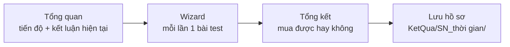
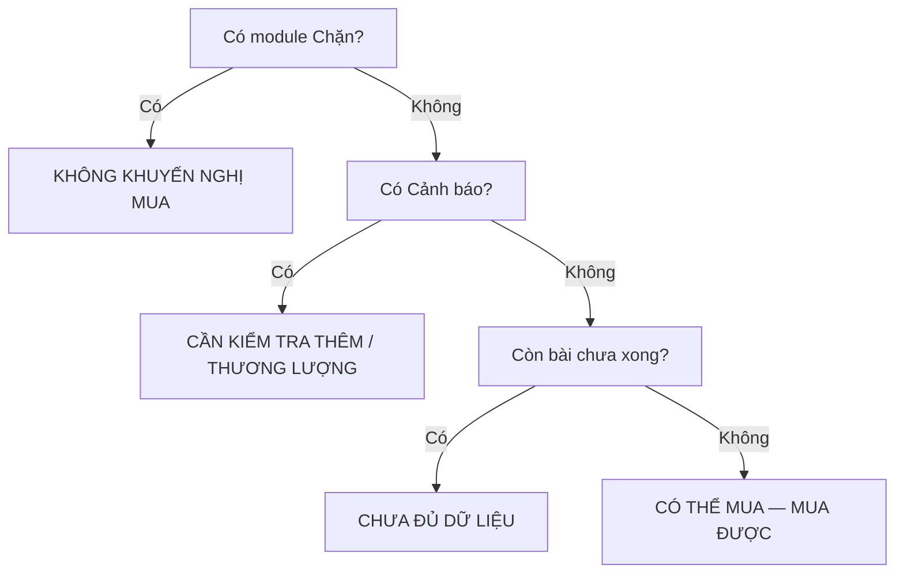

<p align="center">
  
</p>

# An Tâm PC Test

[](https://github.com/YHresearcher/PCcheck/actions/workflows/build-windows.yml)
[](LICENSE)
[]
[]

**Công cụ kiểm tra PC / Laptop cũ — Vi tính An Tâm | Chuyên máy đã qua sử dụng, chuẩn doanh nghiệp**

Tool test máy tính cũ trước khi bán, của cửa hàng Vi Tính An Tâm. Tool trả lời 1 câu duy nhất: **máy này MUA ĐƯỢC HAY KHÔNG**, dùng chung cho cả kỹ thuật viên lẫn người mua — người mua chỉ cần đọc tiêu đề + câu thân thiện ở trang Tổng kết là đủ, kỹ thuật viên đọc chi tiết từng module ở dưới để biết vì sao.

Bản này dịch sang tiếng Việt và tùy biến từ [BibaYanji](https://github.com/Bibapcs/BibaYanji) v0.0.4 của Bibapcs. Mã gốc theo giấy phép MIT, bản quyền gốc vẫn của Bibapcs, file LICENSE không đổi. Bản gốc tiếng Trung vẫn giữ nguyên ở file `README-BibaYanji-goc.md` trong repo này để đối chiếu.

## Tải bản chạy được

Vào mục **Releases** của repo, tải file **AnTamPCtest-portable.zip** ở Release **"latest"** (luôn là bản mới nhất từ nhánh main) về, giải nén ra USB là chạy. Link tải trực tiếp, không cần đăng nhập GitHub:

https://github.com/YHresearcher/PCcheck/releases/latest/download/AnTamPCtest-portable.zip

Release "latest" chỉ được cập nhật khi build thành công, nên bản lỗi không ghi đè lên bản tốt đang phát hành. Nếu Releases chưa có file (ví dụ build đang chạy hoặc vừa lỗi), cách dự phòng là vào tab **Actions**, bấm vào run **Build Windows portable** mới nhất tick xanh, kéo xuống cuối trang run, tới mục **Artifacts**, tải **AnTamPCtest-portable** về — cách này thì GitHub bắt đăng nhập tài khoản mới tải được, kể cả repo public.

## Chạy portable từ USB

1. Cắm USB vào máy cần test, bấm đúp `AnTamPCtest.exe` ở thư mục gốc vừa giải nén.
2. Bấm Yes khi Windows hỏi quyền Admin, rồi test như bình thường.
3. Test xong, bấm **Lưu hồ sơ phiên này** ở trang Tổng kết để lưu báo cáo ra USB trước khi giao máy (xem mục Lưu hồ sơ bên dưới).

Yêu cầu máy test: Windows 10 bản 2004 trở lên hoặc Windows 11, bản 64-bit, **cần quyền Admin** (để đọc SMART của ổ và một số cảm biến). Máy test không cần cài .NET, vì gói portable là tự chứa.

## Quy trình test



Mở app lên là trang **Tổng quan** (đầu tiên trong menu): tiến độ đã xong x/y bài, kết luận mua máy hiện tại, và các nút: Bắt đầu kiểm tra máy / Tiếp tục phiên dang dở, Xem thông tin phần cứng, Xem sức khỏe thiết bị, Xem kết luận mua máy, Mở thư mục hồ sơ (KetQua). Dashboard không chọn câu nhận xét riêng — câu thân thiện chỉ ở trang Tổng kết, để 2 nơi không hiện 2 câu khác nhau.

Nút Bắt đầu / Tiếp tục vào **chế độ wizard**: menu bên trái bị khóa, mỗi lần chỉ 1 bài test chính, tránh thao tác nhầm. Thanh wizard trên cùng có: Quay lại bài trước, Bài tiếp theo, Dừng tất cả test nặng, Thoát wizard (thoát thì mở lại menu, trạng thái test không mất). Cho qua 1 bài thì tự nhảy bài chưa xong tiếp theo; dừng giữa chừng thì về Dashboard bấm Tiếp tục là nhảy đúng bài chưa xong.

## Các module, theo đúng thứ tự trong app

| # | Module | Làm gì |
|---|--------|--------|
| 0 | Tổng quan (Dashboard) | Tiến độ, kết luận hiện tại, nút bắt đầu/tiếp tục, mở hồ sơ, vào Cài đặt. Chỉ đọc, không phải bài test. |
| 10 | Đối chiếu cấu hình | Tự quét CPU, card màn hình, RAM, ổ, card mạng, màn hình, pin, rồi đối chiếu từng mục với cấu hình đơn hàng. Trình bày kiểu CPU-Z: tab CPU / Memory / Storage / Graphics / Khác, số liệu thô, không phải kết luận. Nhóm Máy & Mainboard (tab Khác) đọc model/serial máy + mainboard + BIOS trực tiếp từ bảng SMBIOS thô của firmware, đối chiếu với WMI, lệch thì báo cảnh báo và bắt kiểm tra tem tay (không chặn). Serial máy và serial mainboard khác nhau là bình thường. Giới hạn: BIOS bị flash giả thì SMBIOS và WMI cùng nói dối giống nhau, khi đó tra serial trên web hãng hoặc soi tem dưới đáy máy. |
| 20 | Test bàn phím | Bàn phím ANSI 104 phím, bấm phím nào thì phím đó sáng lên, nhả ra thì chuyển xanh, đếm "đã test X / 104". Tick tay "Có phím liệt / không nhận" thì ghi nhận lỗi, vẫn cho qua được. |
| 30 | Test điểm chết màn hình | Chọn màn hình rồi xem toàn màn hình đổi màu trắng, đỏ, xanh lá, xanh dương, đen, bấm phím bất kỳ hoặc click chuột để đổi màu, Esc để thoát. Máy nhiều màn hình thì test từng cái. Tick tay "Phát hiện điểm chết / điểm sáng" thì ghi nhận lỗi, vẫn cho qua được. |
| 40 | Camera - Mic - Loa | Camera xem trước trực tiếp, mic có thanh mức âm + ghi / phát lại, loa phát nhạc test. Đủ 3 mục thì bấm cho qua một lần. Tick tay "Loa rè" / "Camera không hoạt động" thì ghi nhận lỗi, vẫn cho qua được. Dòng ghi công bài nhạc test giữ nguyên văn bản gốc, không được đổi. |
| 50 | Test tản nhiệt | Nướng CPU bằng Prime95, nướng GPU bằng FurMark viết lại bằng C# / OpenTK, hoặc nướng cả hai. Có biểu đồ nhiệt độ và công suất CPU / GPU theo thời gian thực. Tick tay "CPU gặp lỗi / crash khi nướng" và "Phát hiện lỗi hiển thị GPU (artifact)" thì chặn cho qua. Nút "Dừng tất cả test nặng" dừng thật Prime95 / FurMark / đo tốc độ ổ, có kiểm chứng (kill xong phải xác nhận tiến trình đã chết, chưa chết thì quét lại theo đường dẫn Tools và báo rõ tên tiến trình còn sống, không hiện "Đã dừng" giả). Trang Tản nhiệt không cho qua khi chưa dừng được thật. |
| 60 | Cổng kết nối & Sạc | App tự quét cổng + test sạc 10 giây (lấy mẫu điện áp + công suất mỗi giây, cho điểm sức khỏe sạc). Cổng vật lý trên vỏ máy (HDMI, VGA, RJ45, USB-A, USB-C, đầu sạc) thì kỹ thuật viên nhìn bằng mắt và tick tay ở cuối trang. Máy có pin mà chưa test sạc hoặc sạc đánh giá Kém thì nút cho qua không cho qua. Máy bàn không có pin thì bỏ qua phần sạc. Điện áp hiển thị là điện áp ở đầu pin, không phải điện áp ra của củ sạc. |
| 70 | Ngoại quan | 8 hạng mục quan trọng, tick tay: vỏ nứt / móp / vỡ góc, bản lề lỏng, màn hình trầy / viền nứt, phím bong / mất phím, cổng móp / gãy chân, pin phồng, thiếu ốc / tem rách / dấu mở máy, trầy xước nhẹ. Tick thì ghi nhận cảnh báo, vẫn cho qua được — trừ **pin phồng thì chặn cho qua**. |
| 80 | Đo tốc độ ổ | Đo tốc độ đọc / ghi tuần tự và ngẫu nhiên, kết quả lưu thành `KetQuaDoO.json` và `LichSuDoO.csv` trong `%APPDATA%\YanJi\disk_result`. |
| 85 | Sức khỏe thiết bị | Chỉ đọc, không phải bài test: đánh giá theo mức độ nghiêm trọng từ kết quả đã test — Đạt / Cảnh báo / Chặn / Chưa test. Chưa test không được hiểu là khỏe; stress ngắn đạt không chứng minh ổn định lâu dài. |
| 90 | Tổng kết | Trang cuối (Terminal, không có nút cho qua riêng): liệt kê kết luận từng module, rồi cho kết luận tổng (mua được hay không), câu thân thiện + dòng "An Tâm nhắn bạn", ô S/N + nút lưu hồ sơ. |
| 95 | Cài đặt | Đường dẫn hồ sơ (để trống = thư mục app \ KetQua, ghi khác nếu muốn lưu thẳng vào USB / ổ riêng), thời lượng nướng khuyến nghị (mặc định 3 phút, 1–60), tự dừng khi đủ thời lượng (mặc định tắt). Giao diện sáng/tối vẫn đổi bằng công tắc ở góc phải trên, thư mục Tools chỉ xem. Cài đặt lưu ở `%APPDATA%\YanJi\settings.json`, theo app, không theo USB. |

Mỗi module bấm cho qua xong là app tự nhảy sang module chưa xong tiếp theo. Bấm "Kiểm tra lại" hoặc "Đặt lại" là xóa trạng thái đã cho qua để test lại từ đầu.

## Kết luận mua máy (trang Tổng kết)



Kết luận tự động, tính từ kết luận từng module, **không chấm điểm 100**:
- Có module Chặn = **KHÔNG KHUYẾN NGHỊ MUA**.
- Không Chặn nhưng có Cảnh báo = **CẦN KIỂM TRA THÊM / THƯƠNG LƯỢNG**.
- Tất cả Đạt = **CÓ THỂ MUA — MUA ĐƯỢC**.
- Còn module chưa xong = **CHƯA ĐỦ DỮ LIỆU** (chưa kết luận mua được hay không).

**KHÔNG MUA không tự sinh ra từ test**, vì test không biết chi phí sửa có đáng hay không. Kỹ thuật viên tự bấm "Đánh dấu không mua máy này" khi máy hỏng nặng không nên mua, kết luận thành **KHÔNG MUA MÁY NÀY**; bấm lại để bỏ đánh dấu và về lại kết luận tự động.

Câu kết luận không viết cố định trong C# nữa, mà đọc từ `Plugins/Summary/Phrasings.json` (đi kèm plugin Tổng kết, copy vào `plugins/summary/` khi build). File hỏng hoặc thiếu thì app dùng câu dự phòng, không crash. Sửa câu thì sửa file JSON này, không cần sửa code. Thứ tự ưu tiên: lỗi nghiêm trọng → lỗi chức năng → cảnh báo linh kiện → thiếu dữ liệu → máy đạt. Thiếu dữ liệu quan trọng thì không được xếp tốt: còn bài nào chưa test xong là về "chưa đủ dữ liệu", không về "có thể mua". Mỗi phiên chỉ random 1 câu phù hợp khi kịch bản đổi, rồi giữ nguyên câu đó cho tới khi kịch bản đổi tiếp hoặc lưu báo cáo (không còn nút đổi câu tay). Câu đã lưu vào báo cáo thì mở lại báo cáo sẽ thấy đúng câu đó, không random lại.

Tín hiệu tự chọn hiện tại: pin chai tính từ % chai lớn nhất (dưới 20% khỏe, 20–dưới 40% chai vừa, từ 40% chai nặng — mốc là ví dụ, không phải tiêu chuẩn cứng); CPU quá nhiệt khi nhiệt tối đa lúc nướng từ 95°C trở lên (mốc nháp, chưa phải tiêu chuẩn chính thức); CPU lỗi và GPU artifact là tick tay ở trang Tản nhiệt và chặn cho qua; phím liệt, điểm chết, loa rè, webcam là tick tay ở từng bài test, vẫn cho qua được nhưng ghi nhận lỗi; bản lề lỏng và trầy nhẹ tick tay ở module Ngoại quan; sạc Kém ra tín hiệu rắc rối nguồn điện; CPU tốt + ổ hao mòn + pin chai cùng lúc ra câu kết hợp B. Pin không đọc được % hoặc máy không có pin thì không báo tín hiệu, không đoán. Kết hợp C chưa tự chọn vì chưa có định nghĩa "cấu hình mạnh". App chưa chấm điểm pin, nhiệt độ hay tốc độ ổ, vì shop chưa chốt ngưỡng cho các mục đó.

## Dòng "An Tâm nhắn bạn" — thơ lục bát theo nhóm tình trạng

Dòng nhắn nhủ là cặp lục bát do chính user viết, chia 5 nhóm tình trạng, hệ thống chọn ngẫu nhiên 1 câu trong nhóm đúng tình trạng (không hiện lời khuyên chung chung):
- **Máy tốt** (máy đạt): vd "Máy ngon chẳng ngại đem soi, / Càng xem càng thích, càng coi càng mừng."
- **Máy khá** (lỗi chức năng nhỏ, máy vẫn dùng được): vd "Máy ngon hợp việc là hay, / Cấu hình quá mạnh, có ngày phí công."
- **Máy cần thương lượng** (cảnh báo linh kiện): vd "Máy này chưa hẳn là tồi, / Giá mà bớt chút, thì ngồi tính sau."
- **Máy nhiều lỗi** (lỗi nghiêm trọng): vd "Nhìn ngoài bóng bẩy như hoa, / Kiểm xong mới biết, hóa ra hơi buồn."
- **Không nên mua** (đánh dấu tay): vd "Thấy xinh chớ vội trao tiền, / Kẻo mai ôm máy, muộn phiền ôm theo."

Nhãn "An Tâm nhắn bạn:" đứng riêng 1 dòng, cặp thơ 2 dòng tiếp theo, toàn bộ in đậm cho nổi. Chỉ ẩn khi chưa đủ dữ liệu. Các câu nghiêm trọng / không mua là câu cảnh báo / thất vọng nên không làm nhẹ cảnh báo. Câu hiện lúc lưu thì khóa vào báo cáo như câu kết luận.

## Kết luận tự động cho ổ (module Đối chiếu cấu hình)

Mỗi ổ trong nhóm "Ổ" có thêm dòng **"Lỗi nghiêm trọng"** và dòng **"Kết luận ổ"**. Kết luận xét **mức độ nghiêm trọng của lỗi trước, ngưỡng sức khỏe chỉ xét sau**:

- Lỗi nghiêm trọng > 0: **CHẶN — thay ổ rồi kiểm tra lại**, bất kể sức khỏe cao bao nhiêu. Ổ 95% nhưng có lỗi vẫn CHẶN. Lỗi nghiêm trọng gồm: NVMe cảnh báo nghiêm trọng (Critical Warning) > 0, lỗi toàn vẹn dữ liệu NVMe 0E > 0, dự phòng NVMe còn dưới ngưỡng, SATA sector đã thay thế (05) / chờ thay thế (C5) / không sửa được (C6) / lỗi không sửa được đã báo (BB) > 0.
- Sức khỏe <70%: **CHẶN** (không có lỗi nghiêm trọng thì vẫn chặn vì mòn quá nhiều).
- Cảnh báo: sức khỏe 70-89%, hoặc lỗi CRC (C7) > 0 (thường do cáp/cổng, kiểm tra cáp rồi test lại, không chặn cứng ổ), hoặc không đọc được lỗi nghiêm trọng nào dù sức khỏe còn cao (chưa biết có lỗi hay không thì không được coi là khỏe). Vẫn cho qua module được, nhưng trang ghi rõ điều kiện.
- Sức khỏe ≥90% và đã đọc được lỗi nghiêm trọng = 0, không có lỗi nào > 0: **ĐẠT — bán nguyên trạng**.
- SMART không đọc được: **Không rõ — kiểm tra tay bằng CrystalDiskInfo, chưa đủ dữ liệu để kết luận**. Không tự cho là tốt, nhưng cũng không chặn cứng — kỹ thuật viên phải kiểm tra tay trước khi bán.

Lỗi NVMe chỉ áp dụng cho NVMe, lỗi SATA chỉ áp dụng cho SATA, không bị chặn oan vì nhầm loại ổ. Sức khỏe % lấy từ SMART qua LibreHardwareMonitor: NVMe = 100 trừ "Percentage Used", SATA = "SSD Life Left" hoặc "Wear Leveling". SMART đọc không được thì các dòng sức khỏe, thời gian đã chạy và lỗi đều hiện "Không rõ", không bịa số.

## Module Cổng kết nối & Sạc — nguồn và những chỗ đã sửa

Module này port từ laptop-diagnostic-tool của Tanxe Studio (giấy phép MIT), các hàm Get-ChargerInfo / Test-AdapterHealth và phần phát hiện cổng trong `FinalDiagnostic_v15.ps1`, port sang C# thành plugin `ports` (thứ tự 60, giữa Test tản nhiệt và Ngoại quan). Ghi công hiển thị trong cửa sổ Quản lý Module, theo đúng cơ chế Credits của app.

Ngưỡng sạc giữ nguyên bản gốc: điện áp dao động <3% Xuất sắc, <5% Tốt, <10% Trung bình, còn lại Kém; không sạc mà pin <99% trừ 50 điểm; điểm ≥85 Xuất sắc, ≥70 Tốt, ≥50 Trung bình, còn lại Kém. Chưa test sạc (máy có pin) hoặc sạc đánh giá Kém thì nút cho qua không cho qua — thay sạc rồi test lại. Máy bàn không có pin thì bỏ qua phần sạc.

Điện áp hiển thị là điện áp ở đầu pin, **không phải** điện áp ra của củ sạc (thường 19-20 V, hệ thống không đo trực tiếp được) — trang ghi rõ điều này.

Những chỗ đã sửa so với bản gốc, cố tình không copy nguyên (chi tiết trong đầu file `Plugins/PortAdapter/PortAdapterService.cs`): bản gốc coi Win32_Battery mã 2 là đã cắm sạc (thực ra 2 = Unknown) — bản này dùng PowerOnline làm căn cứ chính; bản gốc tính mức pin từ thuộc tính MaxCapacity không tồn tại nên luôn ra 0 — bản này lấy dung lượng sạc đầy từ BatteryFullChargedCapacity; bản gốc ước tính công suất rơi về 65 W khi vượt mức lớn nhất — bản này trả "330 W trở lên"; bản gốc đoán số cổng USB từ số root hub và đoán có HDMI từ đời CPU / tên máy rồi mặc định luôn là có — bản này không đoán, chuyển sang tick tay.

Phần cổng tự động chỉ báo những gì hệ thống thật sự nhìn thấy: số USB controller / root hub, thiết bị USB-C / Thunderbolt theo tên, dấu hiệu USB-C PD, card mạng có dây, kết nối màn hình hiện tại. Số root hub không phải số cổng vật lý, card mạng có dây không chứng minh là có ổ cắm RJ45, màn hình đang cắm không phải danh sách cổng — trang ghi rõ từng chỗ này.

## Lưu hồ sơ phiên này (trang Tổng kết)

Ô S/N + nút **"Lưu hồ sơ phiên này"**: mỗi máy 1 thư mục riêng `<thư mục app>\KetQua\<S/N>_<yyyyMMdd_HHmmss>\`, gồm `BaoCao.txt` (kết luận + nhận xét + kết quả từng module + bằng chứng), `KetQua.json` (máy đọc được) và bản sao `KetQuaDoO.json` mới nhất (vì file gốc trong %APPDATA% sẽ bị máy sau ghi đè). Cùng S/N test lại cũng không đè lên nhau nhờ timestamp (+ _2, _3 nếu trùng giây). Chỉ mục `KetQua\DanhSach.csv` thêm 1 dòng/phiên. S/N để trống vẫn lưu được (tên thư mục dùng KhongCoSN). Lưu xong mới test máy tiếp theo. Nếu thư mục app ghi không được thì lưu vào `%APPDATA%\YanJi\KetQua\` và báo rõ, không im lặng lưu chỗ khác.

Ô S/N tự điền từ serial firmware của máy (SMBIOS) khi mở trang Tổng kết, nếu ô đang trống. Nếu firmware không có serial thật (hãng để sẵn chữ giữ chỗ) thì ô để trống cho gõ tay, không bịa số. Nếu bạn sửa hoặc xóa số sau đó thì nó không điền lại, để tôn trọng số gõ tay — vì tem dán khác serial firmware chính là trường hợp cần kiểm tra tay. Số tự điền vẫn có thể sai nếu BIOS từng bị flash lại, nên vẫn cần đối chiếu tem dán.

## Splash screen

Mở app lên là thấy màn hình chờ 480×400 ở giữa màn hình, không có viền cửa sổ, không hiện trên taskbar: logo An Tâm 120px, tên **"An Tâm PC Test"**, dòng **"Công cụ kiểm tra PC/ Laptop cũ"**, dòng **"Vi tính An Tâm | Chuyên máy đã qua sử dụng, chuẩn doanh nghiệp"** màu cam, 2 chi nhánh + vitinhantam.com, và thanh "Đang khởi động...".

Splash hiện trong lúc app tải các module, tự đóng khi cửa sổ chính đã tải xong và đủ tối thiểu 1,5 giây (máy nhanh cũng không bị chớp tắt), rồi chuyển focus sang cửa sổ chính. Không cần bấm gì để tắt. Màu splash theo theme đang dùng (tối = nền xám đậm, sáng = nền kem ấm), logo cam nổi trên cả hai nền.

Thanh trên cùng của cửa sổ chính có dải cam 3px, tên app + dòng phụ, cuối thanh điều hướng trái có nút **"Tham quan shop"** (mở vitinhantam.com trong trình duyệt mặc định, hiện trên mọi trang) và dòng **"An Tâm PC Test v1.1.0"**.

## Vi Tính An Tâm

- Chi nhánh 1: 52 Nguyễn Cửu Vân, P. Long An, T. Tây Ninh
- Chi nhánh 2: 218/3 đường số 11, phường Thủ Đức, Tp. HCM
- Website: vitinhantam.com
- Email: hello@vitinhantam.com
- Máy bán ra đã kiểm tra toàn bộ trước khi giao, bảo hành 6 tháng nguyên máy.
- An Tâm bán máy đã qua sử dụng đã test kỹ, **không phải tiệm sửa máy**. An Tâm **không có showroom bán lẻ**, không nhận máy ngoài vào sửa.

## Giao diện thương hiệu An Tâm

- Màu cam logo: **#ED740C** (đo trực tiếp từ file logo gốc). Logo nằm ở `验机软件/Assets/logo-antam.png`, nhúng vào exe, hiện ở top bar bên trái tên app và ở splash screen.
- Icon app và icon trình cài đặt là logo An Tâm, tạo từ chính file logo trên (`验机软件/app.ico`, đủ 16/32/48/64/128/256px, nền trong suốt).
- Hai theme đều dùng cam, chỉ đổi sắc độ cho đủ tương phản, không đổi tên hay số lượng token trong `Themes/Light.xaml` và `Themes/Dark.xaml`:
  - Sáng (dùng ban ngày): nền trắng, nền phụ #FFF6EC, cam #D95E00, hover #C25200, mục đang chọn #FFE7CC.
  - Tối (giao diện thương hiệu chính, nền gần đen như logo trình bày): nền #111111, nền phụ #262626, cam đúng #ED740C, hover #F5861F, mục đang chọn #3D2A1A.
- Vì toàn bộ control đều dùng DynamicResource trỏ vào token theme nên đổi 2 file theme là toàn bộ app đổi màu theo, không cần sửa từng trang. Màu đỏ lỗi giữ nguyên #C42B1C / #FF6B5E, không dùng cam cho lỗi để khỏi nhầm.
- Font chính đổi thứ tự thành "Segoe UI, Microsoft YaHei UI" cho chữ tiếng Việt có dấu hiển thị đúng; font Consolas ở các ô log giữ nguyên.
- Hệ thống theme lần đầu chạy theo theme của Windows, nút mặt trời / mặt trăng ở top bar đổi theme và lưu lại lựa chọn.

## Build trên máy Windows có .NET SDK 10

Chạy từ thư mục gốc của repo này, đúng thứ tự sau, không đổi thứ tự (bước restore phải chạy trước, vì các plugin build bằng MSBuild target cần file assets của NuGet, thiếu bước này là build lỗi):

```bat
dotnet restore 验机软件.slnx
dotnet publish FurMark/FurMark.csproj -p:PublishProfile=FolderProfile
dotnet publish 验机软件/验机软件.csproj -p:PublishProfile=FolderProfile
```

Thư mục `publish` thu được là gói tự chứa, máy test không cần cài .NET. Gói publish đã lược bỏ các thư mục ngôn ngữ runtime không dùng (fr, cs, de...) để zip nhẹ hơn — app chỉ dùng tiếng Việt nên không cần chúng.

Muốn đóng gói trình cài đặt thì chạy tiếp bằng Inno Setup 6:

```bat
"%ProgramFiles(x86)%\Inno Setup 6\ISCC.exe" installer\setup.iss
```

File cài đặt thu được là `AnTamPCtestSetup-v1.1.0-VN.exe` trong thư mục `installer`, cài mặc định vào `{autopf}\AnTamPCtest`.

Nếu đang xài Mac, đọc file `Huong_dan_build_tren_Mac.md` trong repo này trước: cách khuyên dùng là GitHub Actions (file `.github/workflows/build-windows.yml` đã có sẵn, push lên GitHub rồi tải artifact về), ngoài ra còn có cách máy ảo Windows trên Mac và cách điều khiển máy Windows từ xa. Không build trực tiếp được trên Mac, và Mac chip M cũng không có Boot Camp. App build xong chỉ test được máy Windows.

## Giới hạn đã biết, không phải lỗi

1. **Vẫn cần quyền Admin.** App cần quyền Admin để đọc SMART của ổ và một số cảm biến.
2. **Máy test cần Windows 10 bản 2004 trở lên hoặc Windows 11, bản 64-bit.**
3. **Driver PawnIO không đi theo USB.** Driver này là driver nhân, để đọc nhiệt và công suất CPU lúc nướng máy. Nó phải cài riêng trên từng máy test, không cài thì app vẫn chạy, chỉ mất 2 đường nhiệt và công suất CPU trong lúc nướng.
4. **Trạng thái thô của các module nằm trong `%APPDATA%\YanJi` trên máy test, không nằm trên USB.** Điểm ổ nằm trong `%APPDATA%\YanJi\disk_result`. Nhưng hồ sơ phiên đã lưu (BaoCao.txt + KetQua.json + bản sao KetQuaDoO.json) thì nằm trong thư mục `KetQua` của app (tức là trên USB nếu chạy portable từ USB) — test xong bấm lưu hồ sơ trước khi giao máy, rồi xóa thư mục `%APPDATA%\YanJi` trên máy test nếu cần.
5. **Các thay đổi mới nhất chưa kiểm chứng trên máy Windows thật.** Bản build từ GitHub Actions biên dịch được, nhưng các tính năng mới thêm gần đây (wizard, dashboard, sức khỏe thiết bị, nhóm thơ, khối thông tin splash...) vẫn cần chạy thử trên laptop Windows thật mới khẳng định được.

## Ghi công và giấy phép

- BibaYanji của Bibapcs — code chính, giấy phép MIT, file LICENSE gốc giữ nguyên. Các thành phần kèm theo giữ giấy phép riêng của chúng: LibreHardwareMonitor (MPL-2.0), Prime95 (GIMPS freeware), PawnIO (GPL-2.0 có ngoại lệ), CrystalDiskMark và diskspd (MIT), NAudio (Ms-PL), OpenTK (MIT), FurMark bản Python gốc (MIT). Khi copy hay phát lại thư mục này, giữ nguyên các file LICENSE kèm theo, đừng xóa.
- Module Cổng kết nối & Sạc — port từ laptop-diagnostic-tool của Tanxe Studio, giấy phép MIT, ghi công trong cửa sổ Quản lý Module.
- Bài nhạc test ở trang Camera - Mic - Loa: xem `AUDIO-LICENSE.md`.
- App này không tích hợp phần mềm thương mại đóng nguồn nào (ví dụ HWiNFO) vào code, theo quy tắc của repo gốc. Thu thập phần cứng chỉ qua LibreHardwareMonitor và giao diện có sẵn của Windows (WMI, registry, Win32).

## Còn sót lại, cố tình giữ nguyên hoặc chưa dịch được

- Nút chuẩn của trình cài đặt Inno Setup (như Tiếp theo, Quay lại, Hủy, Duyệt) vẫn tiếng Trung, vì trình cài đặt đang dùng file ngôn ngữ `ChineseSimplified` có sẵn của Inno Setup, chưa có file ngôn ngữ tiếng Việt đi kèm. Muốn hết hẳn thì cần thêm file `.isl` tiếng Việt cho Inno Setup.
- Dòng ghi công bài nhạc test ở trang Camera - Mic - Loa giữ nguyên văn bản gốc, theo quy tắc của repo gốc là không được đổi dòng ghi công đó.
- Tên file exe chính là AnTamPCtest.exe. Tên file nhạc test vẫn giữ nguyên, vì đổi tên sẽ làm app không tìm thấy file nhạc.
- Comment trong code vẫn tiếng Trung, chỉ người đọc code mới thấy, người dùng cuối không thấy.
