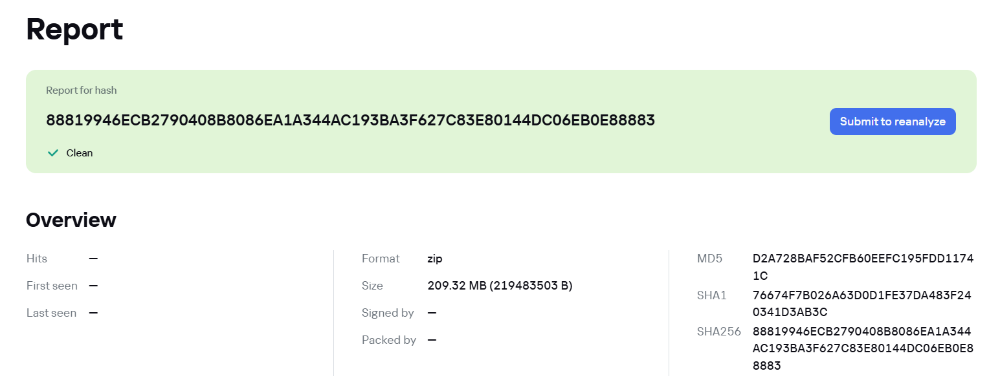
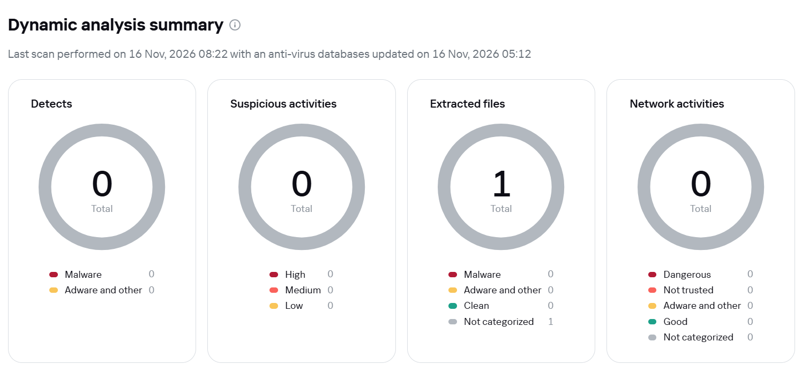

<p align="center">
  
</p>

# An Tâm Check

[](https://github.com/YHresearcher/PCcheck/actions/workflows/build-windows.yml)
[](LICENSE)
[]
[]

[Tiếng Việt](README.md)

A tool for testing used PCs / laptops before buying — it answers one question: **CAN THIS MACHINE BE BOUGHT OR NOT**, for both technicians and buyers. Translated and customized from [BibaYanji](https://github.com/Bibapcs/BibaYanji) v0.0.4 by Bibapcs (MIT). Original Chinese README: `README-BibaYanji-goc.md`.

**Download the latest build:** [AnTamPCtest-portable.zip](https://github.com/YHresearcher/PCcheck/releases/latest/download/AnTamPCtest-portable.zip) — extract to a USB drive and run `AnTamPCtest.exe` as Administrator. Each push to main that builds successfully creates a new Release (tag `build-<run number>-<attempt>`, marked Latest); a failed build creates no Release, so the good build in circulation is never overwritten.

## Virus scan (latest Release)

The portable `AnTamPCtest-portable.zip` (build-99-1) was scanned on the [Kaspersky Threat Intelligence Portal](https://opentip.kaspersky.com/) on 16 Nov 2026 — result **Clean**: 0 malware detections, 0 suspicious activities, 0 network activities. Scanned file: 209.32 MB (219,483,503 bytes), SHA256 `88819946ECB2790408B8086EA1A344AC193BA3F627C83E80144DC06EB0E88883`, MD5 `D2A728BAF52CFB60EEFC195FDD11741C` — matching the zip currently published, which anyone can verify by downloading the file and checking its SHA256.





## Requirements

- Windows 10 (version 2004 or later) or Windows 11, 64-bit.
- Administrator rights (to read drive SMART data and some sensors).
- No .NET installation needed — the portable package is self-contained.
- The PawnIO driver (installed separately on each test machine) is only needed to read CPU temperature and power while stress-testing; without it those two readings are blank and the app still runs.

## How to use

Open the app → the **Dashboard** shows progress and the current verdict → click **Kiểm tra chi tiết** (Detailed check) to enter the wizard (one test at a time; finishing a test auto-advances to the next unfinished one) → when all are done, go to **Tổng kết** (Summary) to see whether the machine can be bought → click **Lưu hồ sơ phiên này** (Save this session) to save the report to the USB drive before handing the machine over.

## Modules

| # | Module | What it does |
|---|--------|--------------|
| 0 | Dashboard | Progress + current verdict. Read-only, not a test. |
| 10 | Config Check | Scans CPU, RAM, drives, GPU and battery, then compares them against the order configuration (CPU-Z style). |
| 20 | Keyboard Test | 104-key keyboard; the key you press lights up. |
| 30 | Dead Pixel Test | Full-screen color changes to find dead / bright pixels. |
| 40 | Camera - Mic - Speaker | Live camera preview, mic level meter, test music for the speaker. |
| 50 | Stress Test | Stresses the CPU (Prime95) / GPU (FurMark) with live temperature and power charts. |
| 60 | Ports & Charging | Scans ports and runs a 10-second charger test (voltage + power). |
| 70 | Appearance | 8 manual checkboxes; a swollen battery blocks passing. |
| 80 | Disk Speed Test | Measures sequential and random read / write speeds and concludes whether the drive is good. |
| 85 | Device Health | Read-only: Pass / Warning / Blocked / Not tested. |
| 90 | Summary | Buy verdict + the "An Tâm nhắn bạn" note + save session. |

## Buy verdict (Summary page)

- A Blocked module → **NOT RECOMMENDED**
- No Blocked module but a Warning → **CHECK MORE / NEGOTIATE**
- All Pass → **CAN BUY**
- Tests still unfinished → **NOT ENOUGH DATA — NO VERDICT YET**
- Technician marks it manually → **DO NOT BUY THIS MACHINE**

The verdict is rule-based, **no 100-point score**. Verdict sentences are read from `Plugins/Summary/Phrasings.json` (edit the sentences there, no code change needed).

## Drive verdict (automatic, in Config Check)

- Serious errors > 0, or health < 70% → **BLOCKED** (replace the drive and re-test).
- Health 70–89%, CRC errors, or no serious-error field readable → **Warning**.
- Health ≥ 90% with no serious errors → **Pass**.
- SMART unreadable → **Unknown** (check manually with CrystalDiskInfo; never assumed good).

## Save this session

A serial-number box (auto-filled from the firmware serial) + the **Lưu hồ sơ phiên này** (Save this session) button → `<app folder>\KetQua\<serial>_<yyyyMMdd_HHmmss>\`, containing `BaoCao.txt`, `KetQua.json` and a copy of the latest disk-test result. The index `KetQua\DanhSach.csv` gains one line per session.

## Build from source (Windows, .NET SDK 10)

```bat
dotnet restore 验机软件.slnx
dotnet publish FurMark/FurMark.csproj -p:PublishProfile=FolderProfile
dotnet publish 验机软件/验机软件.csproj -p:PublishProfile=FolderProfile
```

Installer (Inno Setup 6): `"%ProgramFiles(x86)%\Inno Setup 6\ISCC.exe" installer\setup.iss` → `AnTamPCtestSetup-v1.1.0-VN.exe`. Cannot be built directly on a Mac — use GitHub Actions (`.github/workflows/build-windows.yml`).

## Known limitations

- Administrator rights are still required.
- The PawnIO driver does not travel with the USB drive (install it separately on each test machine).
- Raw module state lives in `%APPDATA%\YanJi` on the test machine, not on the USB drive — but saved session files live in the app's `KetQua` folder (on the USB drive).
- New features have not yet been verified on a real Windows machine — checklist: `docs/WINDOWS-QA-v2.md`.

## Credits and license

- BibaYanji by Bibapcs — main code, MIT license, original LICENSE file kept. Bundled components keep their own licenses: LibreHardwareMonitor (MPL-2.0), Prime95 (GIMPS freeware), PawnIO (GPL-2.0), CrystalDiskMark and diskspd (MIT), NAudio (Ms-PL), OpenTK (MIT), Be Vietnam Pro (OFL-1.1). The Ports & Charging module was ported from Tanxe Studio's laptop-diagnostic-tool (MIT).
- The app integrates no closed-source commercial software (e.g. HWiNFO). Hardware data comes only from LibreHardwareMonitor and built-in Windows interfaces (WMI, registry, Win32).
- Test music on the Camera - Mic - Speaker page: see `AUDIO-LICENSE.md`.

## Leftovers

- Inno Setup installer buttons are still in Chinese (no Vietnamese `.isl` language file yet).
- The main exe is named `AnTamPCtest.exe`. The test music attribution line is kept verbatim from the original.
