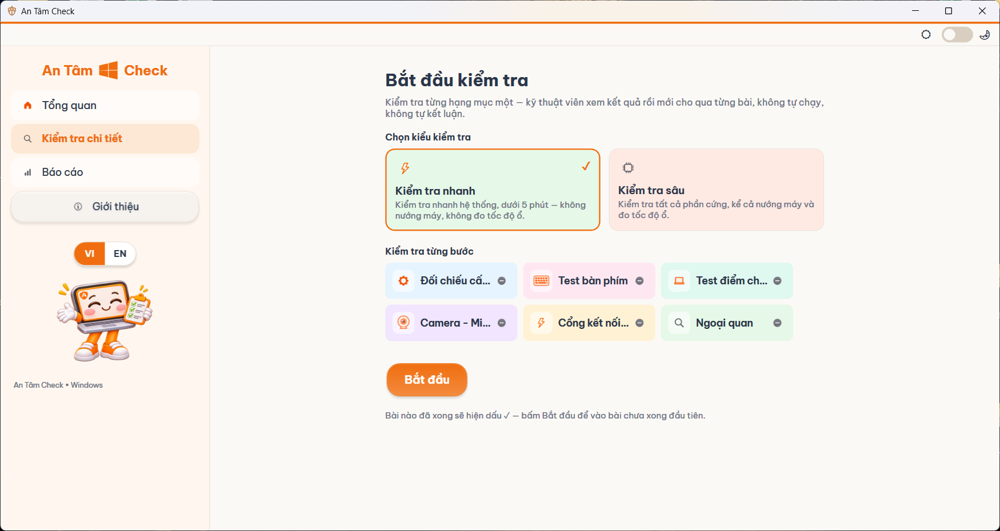
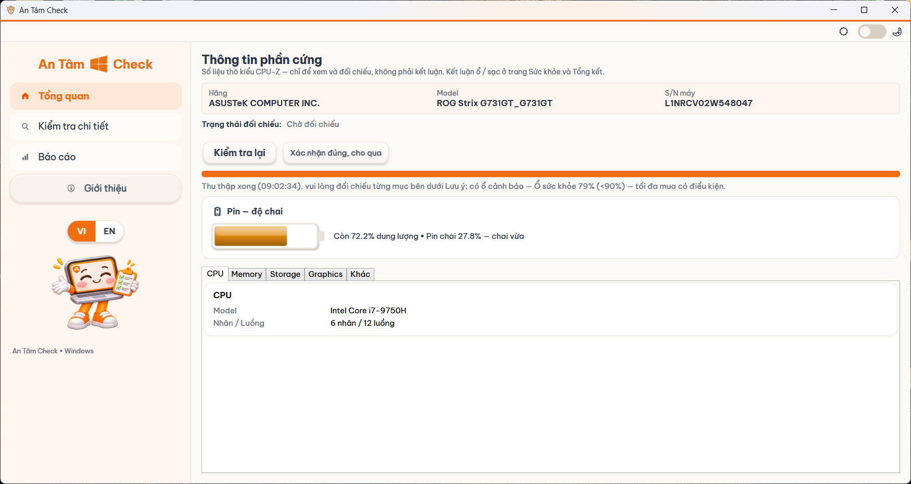
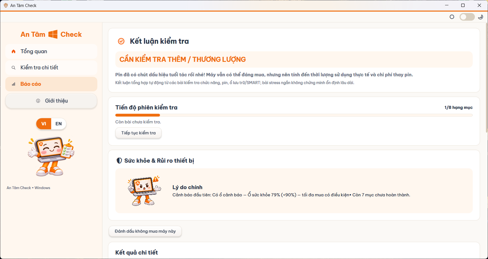
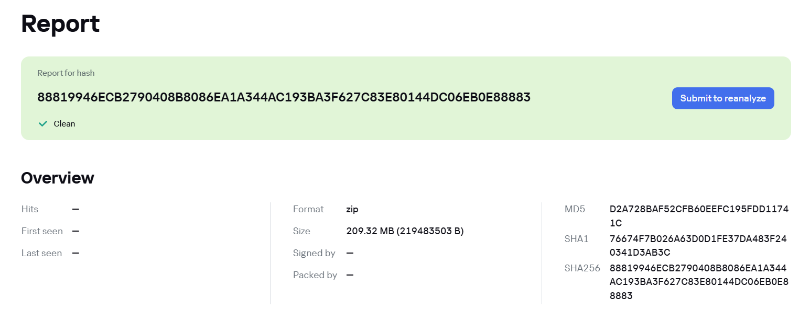
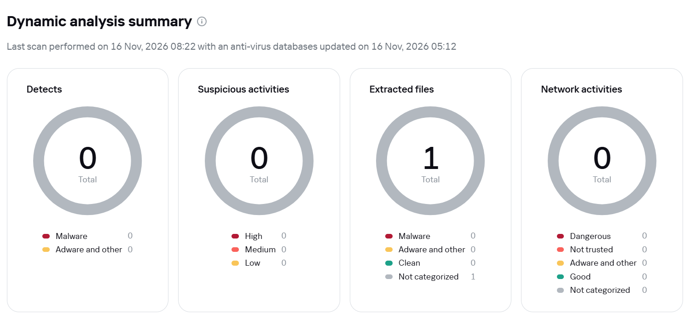

  

# An Tâm Check

[]
[]

[English](README.md)

Công cụ kiểm tra PC / Laptop cũ trước khi mua — trả lời 1 câu duy nhất: **máy này MUA ĐƯỢC HAY KHÔNG**, dùng chung cho cả kỹ thuật viên lẫn người mua. Dịch và tùy biến từ [BibaYanji](https://github.com/Bibapcs/BibaYanji) v0.0.4 của Bibapcs (MIT). Bản gốc tiếng Trung: `README-BibaYanji-goc.md`.

## Ảnh chụp màn hình

## Kiểm tra virus (bản Release mới nhất)

Bản portable `AnTamPCtest-portable.zip` (build-99-1) đã quét trên [Kaspersky Threat Intelligence Portal](https://opentip.kaspersky.com/) ngày 16/11/2026 — kết quả **Clean**: 0 phát hiện malware, 0 hoạt động đáng ngờ, 0 hoạt động mạng. File quét: 209,32 MB (219.483.503 byte), SHA256 `88819946ECB2790408B8086EA1A344AC193BA3F627C83E80144DC06EB0E88883`, MD5 `D2A728BAF52CFB60EEFC195FDD11741C` — các mã này ứng với đúng file zip của build-99-1 (bản mới hơn được đóng gói lại nên hash có thể khác).

## Yêu cầu

- Windows 10 (bản 2004 trở lên) hoặc Windows 11, 64-bit.
- Quyền Admin (để đọc SMART của ổ và một số cảm biến).
- Không cần cài .NET — gói portable tự chứa.
- Driver PawnIO (cài riêng trên từng máy test) chỉ cần khi muốn đọc nhiệt độ và công suất CPU lúc nướng máy; không có thì 2 dòng đó trống, app vẫn chạy.
- Chỉ cần [.NET SDK 10](https://dotnet.microsoft.com/en-us/download/dotnet/10.0) nếu tự build từ source.

## Cách dùng

Mở app → trang **Tổng quan** xem tiến độ và kết luận hiện tại → bấm **Kiểm tra chi tiết** vào wizard (mỗi lần 1 bài test, xong 1 bài tự nhảy sang bài chưa xong tiếp theo) → xong hết sang **Tổng kết** xem mua được hay không → bấm **Lưu hồ sơ phiên này** để lưu báo cáo ra USB trước khi giao máy.

## Các module

| # | Module | Làm gì |
|---|--------|--------|
| 0 | Tổng quan | Tiến độ + kết luận hiện tại. Chỉ đọc, không phải bài test. |
| 10 | Đối chiếu cấu hình | Quét CPU, RAM, ổ, GPU, pin rồi đối chiếu với cấu hình đơn hàng (kiểu CPU-Z). |
| 20 | Test bàn phím | Bàn phím 104 phím, bấm phím nào sáng phím đó. |
| 30 | Test điểm chết màn hình | Đổi màu toàn màn hình, tìm điểm chết / điểm sáng. |
| 40 | Camera - Mic - Loa | Xem trước camera, đo mic, phát nhạc test loa. |
| 50 | Test tản nhiệt | Nướng CPU (Prime95) / GPU (FurMark), biểu đồ nhiệt độ và công suất theo thời gian thực. |
| 60 | Cổng kết nối & Sạc | Quét cổng, test sạc 10 giây (điện áp + công suất). |
| 70 | Ngoại quan | 8 hạng mục tick tay; pin phồng thì chặn cho qua. |
| 80 | Đo tốc độ ổ | Đo đọc / ghi tuần tự và ngẫu nhiên, kết luận ổ tốt hay không. |
| 85 | Sức khỏe thiết bị | Chỉ đọc: Đạt / Cảnh báo / Chặn / Chưa test. |
| 90 | Tổng kết | Kết luận mua + dòng nhắn "An Tâm nhắn bạn" + lưu hồ sơ. |

## Kết luận mua (trang Tổng kết)

- Có module Chặn → **KHÔNG KHUYẾN NGHỊ MUA**
- Không Chặn nhưng có Cảnh báo → **CẦN KIỂM TRA THÊM / THƯƠNG LƯỢNG**
- Tất cả Đạt → **CÓ THỂ MUA — MUA ĐƯỢC**
- Còn bài chưa xong → **CHƯA ĐỦ DỮ LIỆU**
- Kỹ thuật viên đánh dấu tay → **KHÔNG MUA MÁY NÀY**

Kết luận tự động, **không chấm điểm 100**. Câu kết luận đọc từ `Plugins/Summary/Phrasings.json` (sửa câu thì sửa file JSON, không cần sửa code).

## Kết luận ổ (tự động, ở Đối chiếu cấu hình)

- Lỗi nghiêm trọng > 0, hoặc sức khỏe < 70% → **CHẶN** (thay ổ rồi kiểm tra lại).
- Sức khỏe 70–89%, lỗi CRC, hoặc không đọc được lỗi nghiêm trọng nào → **Cảnh báo**.
- Sức khỏe ≥ 90% và không có lỗi nghiêm trọng → **Đạt**.
- SMART không đọc được → **Không rõ** (kiểm tra tay bằng CrystalDiskInfo, không tự cho là tốt).

## Lưu hồ sơ phiên này

Ô S/N (tự điền từ serial firmware) + nút **Lưu hồ sơ phiên này** → `<thư mục app>\KetQua\<S/N>_<yyyyMMdd_HHmmss>\`, gồm `BaoCao.txt`, `KetQua.json` và bản sao kết quả đo ổ mới nhất. Chỉ mục `KetQua\DanhSach.csv` thêm 1 dòng/phiên.

## Giới hạn đã biết

- Vẫn cần quyền Admin.
- Driver PawnIO không đi theo USB (cài riêng từng máy test).
- Trạng thái thô của các module nằm trong `%APPDATA%\YanJi` trên máy test, không nằm trên USB — nhưng hồ sơ đã lưu thì nằm trong thư mục `KetQua` của app (trên USB).
- Các tính năng mới chưa kiểm chứng trên máy Windows thật — checklist: `docs/WINDOWS-QA-v2.md`.

## Ghi công và giấy phép

- BibaYanji của Bibapcs — code chính, giấy phép MIT, file LICENSE gốc giữ nguyên. Các thành phần kèm theo giữ giấy phép riêng: LibreHardwareMonitor (MPL-2.0), Prime95 (GIMPS freeware), PawnIO (GPL-2.0), CrystalDiskMark và diskspd (MIT), NAudio (Ms-PL), OpenTK (MIT), Be Vietnam Pro (OFL-1.1). Module Cổng kết nối & Sạc port từ laptop-diagnostic-tool của Tanxe Studio (MIT).
- App không tích hợp phần mềm thương mại đóng nguồn nào (ví dụ HWiNFO). Thu thập phần cứng chỉ qua LibreHardwareMonitor và giao diện có sẵn của Windows (WMI, registry, Win32).
- Bài nhạc test ở trang Camera - Mic - Loa: xem `AUDIO-LICENSE.md`.

## Còn sót lại

- Nút trình cài đặt Inno Setup vẫn tiếng Trung (chưa có file ngôn ngữ tiếng Việt `.isl`).
- Tên file exe chính là `AnTamPCtest.exe`. Dòng ghi công bài nhạc test giữ nguyên văn bản gốc.
